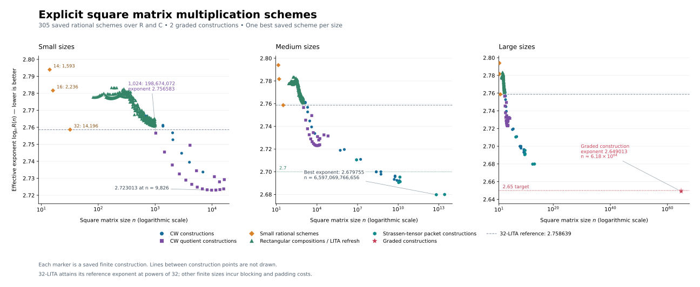
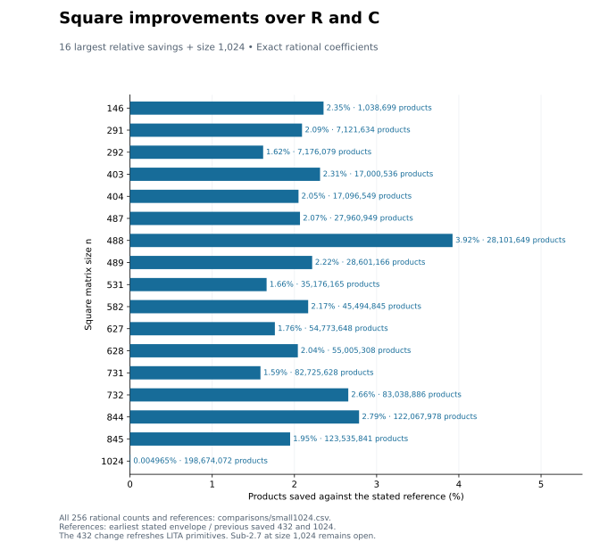

# Explicit matrix multiplication schemes

This is the result of an auto-research experiment with Opus 5.5 and GPT6 Astra, aimed at finding explicit fast matrix multiplication algorithms. The objective was to see if insights from the record asymptotic constructions, which use the Coppersmith-Winograd tensor but give galactic algorithms, could be brought down to explicit algorithms with decent exponents. In a nutshell, it is difficult to do much better than Strassen, but one can improve on the state of the art. Most remarkably, to get an exponent below $2.7, i.e. a matmul algo with $\leq n^{2.7}$ multiplications, requires "only" slightly more than $n\geq 5.10^8$, which is not yet completely galactic. I am still hopeful the exponent can be brought down with more grind.

The auto-research loop ran for a few days, with fairly rare pointers from me. Everything in this repo, apart from the beginning of this README, has been written by Opus 5.5 and GPT6 Astra. Please fork and improve!

Most schemes use Coppersmith–Winograd (CW) tensor restrictions, rational compression and composition with published algorithms. Every coefficient is accessible as an exact rational number.

Between sizes 1,024 and 65,536, the best entries come from a Z4-symmetric CW packet quotiented to 7 products and fed to Strassen's algorithm. Splitting ordinary labels on the Z4-fixed coordinate 8, using the odd input character across all q, and retaining the q² + q gauged Strassen cancellations lowers every Z4 entry: size **9,826** needs **74,352,302,450** multiplications (effective exponent **2.723013**), size **65,536** needs **14,329,410,937,002** (saving **3.10 × 10¹⁰** products with the current size-24 LITA outer), and size **1,024** now needs **198,674,072** (**5,120** fewer than the preceding 198,679,192 entry, and **9,864** fewer than the original even-character entry — 1.43% below 14,197² = 201,554,809). Coordinate-refined 24-row packets also lower sizes **2,916**, **4,000** and **6,912**, while Pair-Schur recursive CW leaves lower all medium-large CW towers through **12,310,160,190** (exponent **2.692126**).

Strassen-tensor packets (`S_q` packets) with stronger tripartite Ruzsa–Szemerédi supports, exact zero-factor trimming (`zero-trimmed-v1`) and middle-weight boundary pruning further improve the large regime. Size **8,388,608** now needs **5,840,735,512,742,068,224** multiplications (39 zero-trimmed power-18 S₈ packets of 364 rows with zero spare slots, 2.72% fewer than 40 · 9¹⁸; exponent **2.710472**). Size **10,847,773,692** (28 · 9⁹) reaches **2.690487** in a single power-27 S₉ packet, size **13,947,137,604** (and padded **13,468,840,704**) falls to **1,999,777,625,038,419,124,331,158,713**, and a single power-36 packet built from Hill's 112-cap in F₃⁶ reaches **2.679755** at size **6,597,069,766,656** (96 · 8¹²) and **2.679931** at **27,113,235,502,176** (96 · 9¹²), now the best below 10⁶⁴. Pairing the latter with an optimal integer grading (d = 203) of the width-6 Aronov–Landsberg puzzle lowers the strict sub-2.65 crossing by **13,447×** to **≈ 5.85 × 10⁶⁴** (natural **≈ 6.18 × 10⁶⁴**, exponent **2.649013**). See [Strassen-tensor packets](#strassen-tensor-packets-sizes-8388608-to-27113235502176).



The panels show small sizes (through 16,384), medium sizes (through 10¹⁴),
and large sizes (the full catalogue).
All use logarithmic size axes. The main figure contains only rational schemes
valid over R and C; characteristic-two results remain separate.

The exponent of a finite scheme is **logₙ R**, where R counts bilinear scalar multiplications. Additions and multiplications by fixed constants are excluded. These are algebraic reference constructions; the counts do not establish a practical speedup over numerical matrix multiplication libraries.

## Quick start

Requires Python 3.11 or newer. From a checkout:

```bash
python -m pip install .
cwschemes info 16384
```

```python
import cwschemes

s = cwschemes.load(16384)
assert s.n == 16384
assert s.rank == 317773192464
u = s.coefficient("U", term=0, row=0, col=0)  # fractions.Fraction
print(u)
```

No search needs to be rerun. All required scheme data is included, compressed and hash-checked. Resources are unpacked on demand into `~/.cache/cwschemes`; set `CWSCHEMES_CACHE` to choose another directory. The full coefficient arrays are never allocated. For the enormous graded entries, coefficients have an explicit finite slot-sum definition, whose evaluation is generally computationally prohibitive. Their default coefficient query guard prevents accidentally starting such a sum; see [coefficient access](docs/graded_cw.md#ordered-blocks-and-coefficient-access).

First use of a construction can take minutes to build exact intermediate tables. Subsequent queries reuse those tables. See the [release checks](checks/summary.json) for measured verification results.

## Catalogue

| Square size | Multiplications | Effective exponent |
|---:|---:|---:|
| [14](schemes/14.json) | 1,593 | 2.793942453 |
| [16](schemes/16.json) | 2,236 | 2.781676118 |
| [32](schemes/32.json) | 14,196 | 2.758639372 |
| [488](schemes/488.json) | 28,101,649 | 2.770672586 |
| [686](schemes/686.json) | 70,079,906 | 2.766113301 |
| [844](schemes/844.json) | 122,067,978 | 2.763382231 |
| [1,024](schemes/1024.json) | 198,674,072 | 2.756582836 |
| [2,048](schemes/2048.json) | 1,303,338,368 | 2.752687685 |
| [8,192](schemes/8192.json) | 45,396,170,352 | 2.723219350 |
| [9,826](schemes/9826.json) | 74,352,302,450 | 2.723013151 |
| [16,384](schemes/16384.json) | 317,773,192,464 | 2.729229033 |
| [65,536](schemes/65536.json) | 14,329,410,937,002 | 2.731502784 |
| [8,388,608](schemes/8388608.json) | 5,840,735,512,742,068,224 | 2.710471990 |
| [240,619,650](schemes/240619650.json) | 42,618,086,121,773,987,519,250 | < 2.7, exactly checked |
| [240,945,152](schemes/240945152.json) | 42,618,086,121,773,987,519,250 | 2.699810881 |
| [536,870,912](schemes/536870912.json) | 355,833,665,201,619,305,486,442 | 2.697777558 |
| [10,847,773,692](schemes/10847773692.json) | 999,890,642,088,501,413,992,105,581 | 2.690486904 |
| [12,310,160,190](schemes/12310160190.json) | 1,459,677,509,200,058,173,953,355,584 | 2.692125569 |
| [13,947,137,604](schemes/13947137604.json) | 1,999,777,625,038,419,124,331,158,713 | 2.691214140 |
| [6,597,069,766,656](schemes/6597069766656.json) | 22,527,768,312,183,649,740,712,054,999,744,512 | 2.679754846 |
| [27,113,235,502,176](schemes/27113235502176.json) | 999,989,287,389,515,119,218,241,063,598,638,155 | 2.679930719 |
| [≈ 6.18 × 10⁶⁴](docs/graded_cw.md) | 3 · 6,700 · 7¹⁹⁸ | 2.649012577 |
| [≈ 5.85 × 10⁶⁴ (cropped)](docs/graded_cw.md) | 3 · 6,700 · 7¹⁹⁸ | < 2.65, exactly checked |

See [catalogue.json](catalogue.json) for all 305 sizes, or run `cwschemes list`.

Below size 1,024, extending the canonical rectangular closure from dimension 256
to **1,024** — together with generalized uneven block substitution into sparse
exact schemes (`⟨3⟩:23`, `⟨4⟩:48`, `⟨5⟩:93`, `⟨6⟩:153`, `⟨14⟩:1593`, `⟨16⟩:2236`),
dynamic serendipitous block products, unbounded odd LITA (`N ≥ 9`), and 19
CRT-certified rational rectangular primitives — improves **217 square counts at
sizes 81–1,010** (166 by more than one product), including 17 previous catalogue
entries. Size **488** falls from **29,249,283** to **28,101,649** (**3.92%**),
size **844** falls from **125,566,678** to **122,067,978** (**2.79%**), and
re-closing the four rectangular remainder blocks of **686** lowers it from
**70,153,048** to **70,079,906**. See [rectangular.md](docs/rectangular.md) and
[extended_rectangular.md](docs/extended_rectangular.md).



The first sub-2.7 size **in this catalogue** is now **240,619,650**, padded from a natural size-240,945,152 (32 · 14⁶) construction. Its rank R = 42,618,086,121,773,987,519,250 satisfies

```text
240,619,649^27 <= R^10 < 240,619,650^27.
```

This is the strict threshold for this particular scheme, **54.44% smaller** (2.195×) than the preceding threshold of 528,108,169. The natural construction uses the explicit size-32 outer scheme (14,196 calls), 9 power-18 CW packets at q = 14 (1,569 rows each), and 75 recursive size-7,529,536 leaves built from Pair-Schur (m = 4, 5) packets and coordinate-8 refined Z4(14) units. A sub-2.7 construction at size 1,024 remains open.

## Strassen-tensor packets (sizes 8,388,608 to 27,113,235,502,176)

These entries (`cw-mixed-square-v1` packets with `"local_tensor": "strassen-completion-v1"`) replace the CW local tensor by Strassen's tensor Str_q = Σₜ (x₀yₜzₜ + xₜy₀zₜ), t = 1, …, q.

- **Local completion.** S(a,b,c) = Σₜ (a₀+aₜ)(b₀+bₜ)cₜ − a₀b₀ Σₜ cₜ has rank q+1 and integer coefficients. It equals Str_q + Σₜ aₜbₜcₜ, so its only error lies on the all-positive block.
- **Packet and zero trimming.** Coordinate i of a power-N packet (N = 3m) carries S(x,y,z), S(y,z,x) or S(z,x,y) for i // m = 0, 1, 2. Each row is a zero-mask partition (A,B,C) with m coordinates per letter and only the two letters its kind allows. The packet is a direct sum of ⟨q^m⟩ products with **no corrections**. With `"compression": "zero-trimmed-v1"`, local digit q terms whose special-choice masks fail the 2D row-mask downset conditions have an identically zero factor over Q and are omitted; when an outer scheme uses fewer than M rows, keeping middle-weight classes `t ≈ m/2` prunes extreme corners and removes up to 118× more zero terms.
- **Supports.** The support condition is a tripartite Ruzsa–Szemerédi (RS) condition in each weight class, so the row count is Σₜ RS(C(m,t)). Rebuilt supports give **364** rows at power 18 (classes 1, 18, 90, 146, 90, 18, 1), **10,172** rows at power 27, and **329,690** rows at power 36 (using Hill's 112-cap in F₃⁶).
- **Sizes.** Explicit size 32 (14,196 = 39 · 364 calls) fills 39 zero-trimmed power-18 S₈ packets with no spare slots (`8,388,608`). Current LITA size 28 (9,846 calls) fits in 1 pruned power-27 S₉ packet (`10,847,773,692`); size 36 (19,666 calls) fits in 2 zero-trimmed power-27 S₉ packets (`13,947,137,604` and padded `13,468,840,704`); size 96 (323,156 calls) fits in 1 pruned power-36 S₈ or S₉ packet (`6,597,069,766,656` and `27,113,235,502,176`).

The asymptotic ancestor is Strassen's laser-method analysis with Salem–Spencer sets (*J. reine angew. Math.* 375/376, 1987). `cwschemes verify <n>` audits the support, replays the exact local identity and zero-trimming count, and checks sampled exact packet entries; see [the construction](docs/construction.md#strassen-tensor-s_q-packets) and [verification scope](docs/verification.md#strassen-tensor-s_q-packets).

## Z4-quotient schemes (sizes 1,024 to 65,536)

These entries (`cw-z4-gauged-square-v1`, or `z4-quotient-v1` units inside a mixed outer scheme) share one 28-row power-9 CW support invariant under Z4, with separate exact finite-q relation witnesses for every q in `{3, 8, 9, …, 20}`.

- **Packet and coordinate-8 refinement.** The 28 rows form 7 free Z4-orbits, with Möbius corrections on 36 sunflower kernels. Coordinate 8 is fixed by Z4; splitting its ordinary labels into `{1}` and centered `{2, …, q}` preserves Z4 equivariance while exposing additional pair-(0, 2) output-mode relations (`1,883` kept refined patterns from `2,311` nonzero initial patterns).
- **Odd input character and gauged cancellations.** Using χ(g) = −1 on both inputs and the even output character leaves input factors equivariant and removes generator-fixed columns, giving closed-form unit rank

  ```text
  R7_odd,split8(q) = (q^9 + 17q^8 + 122q^7 + 392q^6 + 493q^5 + 123q^4 - 10q^3 - 2q^2) / 4.
  ```

  In the permuted and signed Strassen square embedding (`⟨2q³⟩` for q = 8, …, 20, plus padded 4,096, 5,324 and 13,500), an additional **q² + q** input factors vanish over Q (`72` at q = 8, `306` at q = 17), lowering `1,024` to **198,674,072** and `9,826` to **74,352,302,450**.
- **Composite outers.** Sizes `10,976` and `16,384` place 7 refined odd units inside Strassen squared; `32,768` places 48 units inside `⟨8;336⟩`; `65,536` (padded from `24·14³ = 65,856`) places 927 refined odd units inside current LITA size 24 (rank 6,488, with 1 remainder call swapped into unit batches). See [c4_recompression.md](docs/c4_recompression.md) and [real_character.md](docs/real_character.md).

## Explicit schemes at sizes 14, 16 and 32

These three entries store every coefficient explicitly (sparse rational factor matrices, format `explicit-qcsr-square-v1`). They are points of the exact (γ, r₀) parameter family of the [LITA](https://github.com/khoruzhii/lita) row–column aggregation scheme. Two of LITA's three parameter views are unchanged; the third is re-anchored so that one more raw term vanishes (at size 32: 14,314 raw terms − 104 vanishing − 14 merged = 14,196). The same choice gives one product fewer than the pinned LITA counts 1,594, 2,237 and 14,197. The newer upstream revision [472a79f](https://github.com/khoruzhii/lita/tree/472a79fbc8248423a97bebb3aacbc89e769b9b3e) also attains the saved ranks; these three entries are not claimed as improvements over that revision.

`cwschemes verify 32` evaluates the algorithm on random matrices modulo 2³¹−1; `cwschemes verify 32 --exact` checks every tensor coefficient modulo enough primes to certify equality over Q (a few minutes of CPU at size 32).

## Verify

```bash
# Integrity, exact support/completion identities, counts and coefficient queries:
cwschemes verify 16384
cwschemes verify --all

# Reconstruct and check the rational compression relations as well:
cwschemes verify 1024 --exact
cwschemes verify 9826 --exact

# S_q packet entries: support audit, zero trimming, local identity, sampled packet entries:
cwschemes verify 6597069766656

# Verify the strict sub-2.7 threshold and its compressed recursive leaf:
cwschemes verify 240619650 --exact
```

The default checks are not advertised as a full reduction proof. `--exact` additionally rebuilds the relevant Gram matrices and checks the supplied rational relations, or checks exact zero-factor norms. It can take substantially longer and use more memory, especially for refined orbit proofs. Verification must run without Python's `-O` flag.

The mathematical basis consists of the documented CW identities, group projections, composition rules and published primitive schemes. This is an arithmetic certificate checker, not a formal proof-assistant development. Read [verification.md](docs/verification.md) for the precise scope and the release checks actually performed.

## Literature comparison

The main figure displays our saved R/C schemes; the three explicit small schemes are drawn as diamonds, the Z4-quotient schemes as squares, the rectangular compositions as triangles, the Strassen-tensor packet schemes as hexagons and the graded schemes as stars. All 305 saved points beat their stated pinned comparison in [counts.csv](comparisons/counts.csv). The catalogue does not claim globally optimal ranks or independently established records.

- Up to 16,384, the comparison data uses the same product, padding and scalar-peeling closure for published constructions alone and for published constructions augmented with our saved schemes.
- At larger sizes, each comparison is one explicit published construction, not an exhaustive literature optimum.

The comparison pins [LITA](https://github.com/khoruzhii/lita/tree/c1dd9225df98676e385b53ae7517ff2ea0ec5779) at rank **14,197** for size 32 and includes its even and applicable odd families; the explicit size-14, 16 and 32 entries are one below these pinned counts. Other sources are the [Lille catalogue](https://fmm.univ-lille.fr/) and the documented [Schwartz–Zwecher recompression](https://arxiv.org/abs/2508.01748). Existing scheme certificates retain the exact primitive versions with which they were constructed.

The saved points have [exact comparison recipes](comparisons/recipes.json). [Source revisions](comparisons/sources.json), [all point counts](comparisons/counts.csv), and the [dense finite closure](comparisons/closure.csv) are included.

To rebuild the figures from these pinned inputs:

```bash
python -m pip install '.[plot]'
python comparisons/build.py
python comparisons/small1024.py
```

Characteristic-two experiments are secondary leads toward faster rational schemes.
Their counts, certificates and separate figure are in
[characteristic2/](characteristic2/README.md); the best saving here is **2.43%**
at size 243. No corresponding R/C lift is claimed.

## Format and reuse

The public API uses the direct-output convention

```text
C[i,j] = Σₜ W[t,i,j] (Σₐᵦ U[t,a,b] A[a,b]) (Σ꜀𝒹 V[t,c,d] B[c,d]).
```

Scheme descriptors point to immutable compressed objects. Shared proof objects and recursive leaves are stored once; no files from the discovery repository are required. See [format.md](docs/format.md), [construction.md](docs/construction.md) and the [small runnable example](examples/strassen.py).

The original search programs, cluster launchers, logs and experimental dependencies are deliberately absent. Third-party source and seed provenance is documented in [third_party.md](docs/third_party.md). See [LICENSE](LICENSE) and [CITATION.cff](CITATION.cff) for reuse and citation.
