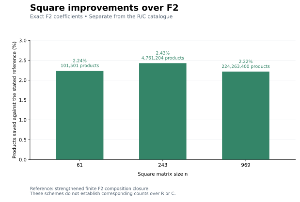

# Characteristic-two square schemes

These explicit schemes work over fields of characteristic two. Their counts
and coefficients are separate from the rational `cwschemes` catalogue.

| Square size | Previous F2 closure | New products | Saving |
|---:|---:|---:|---:|
| 61 | 103,823 | 101,501 | 2,322 (2.237%) |
| 243 | 4,879,681 | 4,761,204 | 118,477 (2.428%) |
| 969 | 229,345,007 | 224,263,400 | 5,081,607 (2.216%) |



These experiments are leads toward rational constructions. The main repository
figure and catalogue concern multiplication over R and C; no lift of these
F2 counts to those fields is claimed.

The reference closure includes published characteristic-two and integer
square primitives, Kronecker products, padding, peeling, rectangular
compositions and uneven Strassen splits. A saving against this reference
does not assert an exhaustive lower bound or a characteristic-zero result.

The construction takes Kronecker powers of AlphaTensor's size-four rank-47
identity, independently permutes row, contraction and column indices at
both Kronecker levels, and restricts a larger square tensor.
It first removes products with a zero restricted factor. Further exact
merges combine products sharing two factors, adding the third factor in F2.
Inner terms are classified by nine row/column/corner survival flags. Each
class has a small masked outer scheme, so the complete merge certificate
and product allocation can be checked without expanding 224 million terms.

The `F2_N.json` files describe the restriction before recompression.
Use `F2_N_class_recompressed.json` for the improved counts:

```python
import sys
sys.path.insert(0, "characteristic2")
from class_recompress_accessor import ClassRecompressed

s = ClassRecompressed("characteristic2/F2_969_class_recompressed.json")
assert s.rank == 224263400
u = s.coefficient(0, 0, 0, 0)  # mode, term, row, col; returns 0 or 1
factors = s.term(0)  # three sparse row-major factors
```

Requires NumPy. `term` returns `(row, col, numerator, denominator)` tuples;
denominators are one. All input files are frozen and hash checked.

Run `python characteristic2/verify.py` to check the primitive tensor, every
coefficient of its size-16 and size-64 Kronecker powers, complete allocations,
and every masked outer tensor before and after merging. This is an exact
compositional proof. Independent inner-permutation wiring and invalid-certificate
rejection checks are included in `inner_permutation_wiring.json` and
`negative_controls.json`. The final size-61 scheme also passed a complete
tensor check over all 13,845,841 input-coordinate pairs, representing
51,520,374,361 tensor coefficients; see `full_tensor_61.json`.
The larger target tensors have not been expanded in full.

## First step toward rational lifting

The frozen size-four rank-47 binary factors have no lift modulo 4 with the
same factor residues. The [520-row witness](4at_mod4_obstruction.json)
annihilates every column of the binary Brent Jacobian but pairs to one with
the first lifting residual. Replay it independently with:

```bash
python characteristic2/verify_mod4_obstruction.py
```

This checks all 4,096 primitive tensor coefficients and all 2,256 derivative
contractions directly from the frozen factors. It also excludes rational lifts
with odd denominators reducing to this seed. It does not exclude other
rank-47 decompositions over Q, R or C, or lifts with even denominators.

## Attribution and license

The primitive is from Alhussein Fawzi et al., *Discovering faster matrix
multiplication algorithms with reinforcement learning*, Nature 610 (2022),
47–53, [DOI](https://doi.org/10.1038/s41586-022-05172-4). The coefficient source
is pinned to [AlphaTensor commit 1949163](https://github.com/google-deepmind/alphatensor/tree/1949163da3bef7e3eb268a3ac015fd1c2dbfc767).
`provenance.json` records its archive hash, the exact coefficient match and
the output-coordinate transpose convention.

AlphaTensor coefficient data in `bases/` and derived data retain the
[Apache License 2.0](AlphaTensor_LICENSE). Changes include exact reduction
to F2, sparse encoding, Kronecker products, index permutations, restriction,
and pair merges. The repository's MIT license covers the new accessor and
verification code. No Kauers–Moosbauer coefficient data is redistributed here.
